# Designing a Serverless REST API with AWS Lambda and API Gateway

## Digital Transformation in Enterprise Systems (TDSE) - Lab 9

## Nicolás Toro Criollo

---

## Project title and description

[TO DO: Fill in your project title and description here]

---

# Orders API — Serverless REST API with AWS Lambda and API Gateway

## 1. API Contract

### Resources
- `orders` (collection): `/orders`
- `order` (single item): `/orders/{id}`

### Order representation
{
  "id": "ORD-001",
  "customerId": "CUST-42",
  "product": "MacBook Air",
  "quantity": 1
}

### Error representation
{
  "error": "ORDER_NOT_FOUND",
  "message": "Order ORD-999 does not exist"
}

### Operations

| Operation | Method | URL | Path param | Query param | Request body | Success | Errors |
|---|---|---|---|---|---|---|---|
| Create order | POST | `/orders` | – | – | `{customerId, product, quantity}` | `201 Created` + order JSON (+ `Location: /orders/{id}`) | `400 INVALID_REQUEST`, `500 INTERNAL_ERROR` |
| Get order | GET | `/orders/{id}` | `id` | – | – | `200 OK` + order JSON | `404 ORDER_NOT_FOUND`, `500 INTERNAL_ERROR` |
| Find by customer | GET | `/orders?customerId={customerId}` | – | `customerId` | – | `200 OK` + JSON array (empty array if none) | `400 MISSING_CUSTOMER_ID`, `500 INTERNAL_ERROR` |
| Delete order (final challenge) | DELETE | `/orders/{id}` | `id` | – | – | `204 No Content` (no body) | `404 ORDER_NOT_FOUND`, `500 INTERNAL_ERROR` |

### Error codes
| HTTP status | `error` | When |
|---|---|---|
| 400 | `INVALID_REQUEST` | Malformed JSON, missing/blank fields, `quantity <= 0` |
| 400 | `MISSING_CUSTOMER_ID` | `GET /orders` without `customerId` |
| 404 | `ORDER_NOT_FOUND` | The order id does not exist |
| 500 | `INTERNAL_ERROR` | Unexpected failure (no internal details leaked) |

## 2. Design Questions

**What are the resources in your API?**
The main resource is the *order*. It is exposed as a collection (`/orders`) and as an individual item (`/orders/{id}`).

**Why did you choose `/orders/{id}` to retrieve a particular order?**
In REST, a URL identifies a resource. The `id` is part of the identity of one specific order, so it belongs in the path. The URL is stable, cacheable, and can be used by DELETE as well, following the same resource-oriented model.

**Why is `customerId` a query parameter in the search operation?**
`customerId` is not the identity of an order; it is a filter applied to the collection `/orders`. Query parameters are meant for optional filtering, searching, and sorting. The collection keeps the same URL and the filter narrows it.

**What should `POST /orders` return when an order is created?**
`201 Created` with the created order in the body (including the server-generated `id`) and a `Location: /orders/{id}` header pointing to the new resource.

**What should the API return when an order does not exist?**
`404 Not Found` with the standard JSON error body (`ORDER_NOT_FOUND`).

**What information should an error response contain?**
A stable, machine-readable `error` code (so clients can branch on it) and a human-readable `message`. It must not expose stack traces or internal details. The HTTP status code carries the category of failure; the body gives the specific reason.

## 3. Part I — Plain Java Application

The application logic is a plain Java 17 library. It has **no dependency** on HTTP,
API Gateway, Spring Boot, a web server or any AWS class. Its only dependency is JUnit,
and only in the `test` scope.

### Structure

orders-api/
├── pom.xml
└── src/
    ├── main/java/edu/eci/tdse/orders/
    │   ├── model/
    │   │   ├── Order.java
    │   │   └── CreateOrderRequest.java
    │   ├── exception/
    │   │   ├── OrderNotFoundException.java
    │   │   └── InvalidOrderException.java
    │   └── service/
    │       └── OrderService.java
    └── test/java/edu/eci/tdse/orders/service/
        └── OrderServiceTest.java

### Design decisions

- **Domain exceptions instead of status codes.** The service signals problems with
  `OrderNotFoundException` and `InvalidOrderException`. It never knows what a "404" is.
  Translating exceptions to HTTP is the job of an outer layer (API Gateway or the adapter).
- **Validation lives in the application logic.** Rules such as "quantity must be positive"
  are business rules, so they must hold regardless of how the service is invoked
  (Lambda direct, API Gateway, a unit test).
- **JavaBean-style model classes** (public no-arg constructor, getters and setters). This
  lets the AWS Lambda Java runtime convert JSON to objects and back in Part II without
  adding any AWS dependency to the model.
- **In-memory storage.** Orders are kept in a `ConcurrentHashMap`. This is *not*
  persistent: Lambda execution environments are ephemeral, so data may disappear
  whenever the environment is recycled.

### Checkpoint 1

**Can the application functionality be tested without AWS?**
Yes. `OrderServiceTest` instantiates `OrderService` directly and runs with `mvn test`.
No AWS account, network access or emulator is needed.

**Does your application require a web server?**
No. The service is a plain Java class with methods. Nothing listens on a port.

**Does it require Spring Boot?**
No. The only dependency is JUnit, restricted to the `test` scope.

**What does the generated JAR contain?**
The compiled `.class` files of the model, exceptions and service, plus
`META-INF/MANIFEST.MF` and the Maven metadata. It contains neither the test classes nor
any third-party library, so it is small and has no transitive dependencies.

**Which parts of your application currently know about HTTP?**
None. The application only knows about orders, customers, products, quantities and
domain exceptions. Status codes and headers will be introduced later, outside this layer.

## 4. Part II — Deploying a Java Function to AWS Lambda

`OrderService.createOrder` is deployed as an AWS Lambda function **without modifying
any Java code**. The Lambda Java runtime accepts a plain public method as handler
(`package.Class::method`), so no AWS dependency was added to the project.

| Setting | Value |
|---|---|
| Function name | `orders-create` |
| Runtime | Java 17 |
| Handler | `edu.eci.tdse.orders.service.OrderService::createOrder` |
| Package | `target/orders-api-1.0.0.jar` |
| Memory / Timeout | 512 MB / 15 s |

### Investigation: JSON ↔ Java conversion in the Lambda Java runtime

The Lambda Java runtime inspects the handler method signature through reflection,
deserializes the incoming JSON into the declared parameter type (`CreateOrderRequest`)
using Jackson, invokes the method, and serializes the returned object (`Order`) back to JSON
through its getters. JSON property names therefore come from JavaBean accessors, which is
why the model classes have a public no-arg constructor and getters/setters.

### Verification against the deployed function

**Valid order** (`quantity: 1`)
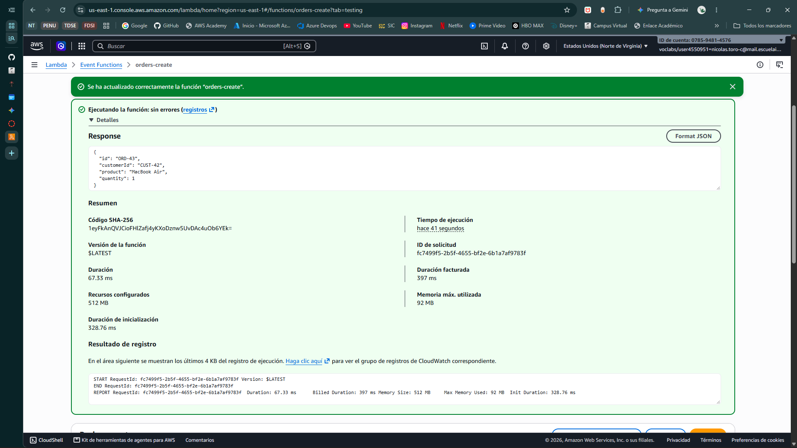
The runtime deserialized the JSON into `CreateOrderRequest`, our method ran, and the returned `Order` was serialized back to JSON.

**Domain error** (`quantity: 0`)
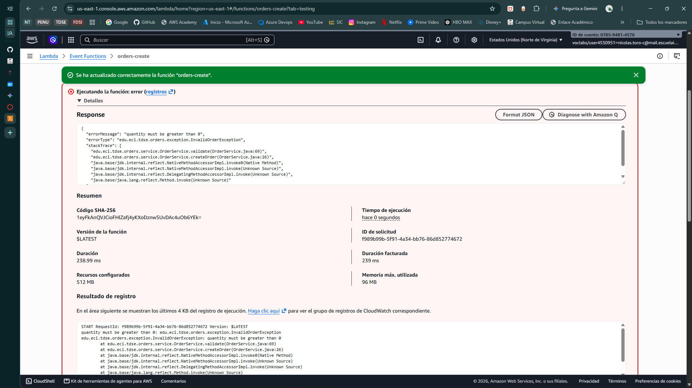
`errorType` is our own `InvalidOrderException`: our code ran and the domain exception crossed the runtime.

**Missing field** (`product` omitted)

The error comes from the runtime's JSON conversion, *before* our method was invoked.

**Type mismatch** (`quantity: "abc"`)
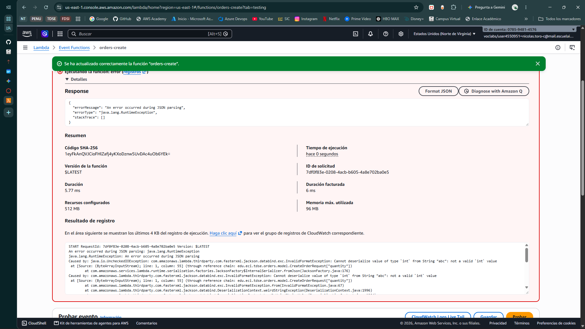
The error comes from the runtime's JSON conversion, *before* our method was invoked.

### Checkpoint 2 — Architecture of Part II

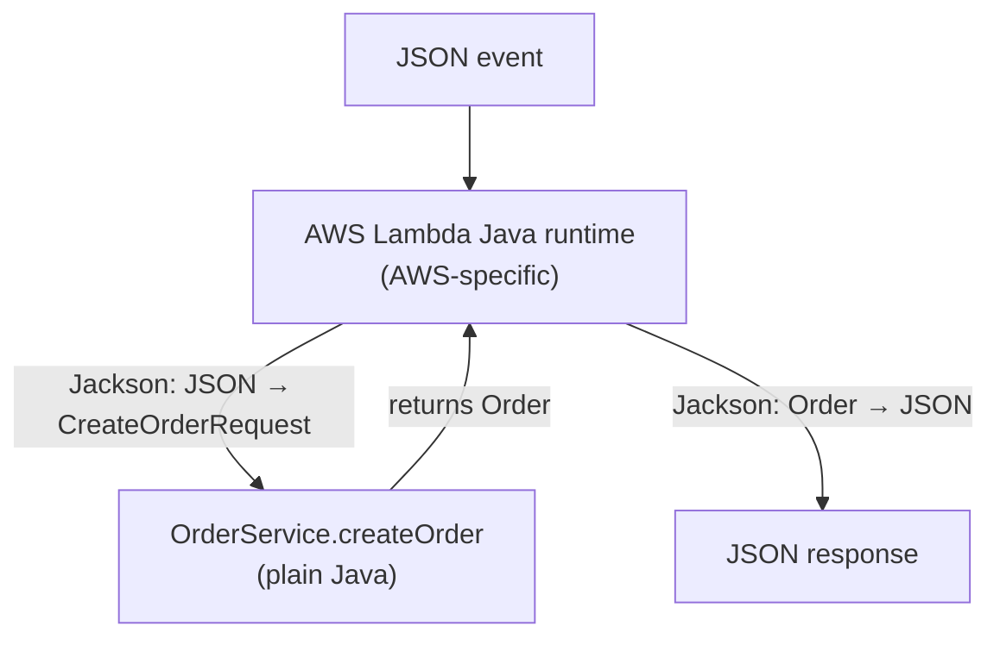
## 5. Parts III & IV — Architecture A: API Gateway Mapping Templates (non-proxy)

A **REST API** (not an HTTP API, which cannot apply mapping templates) exposes the
application with **Lambda custom (non-proxy) integration**. The Java code is unchanged.

| HTTP operation | Lambda function | Handler | Payload built by API Gateway |
|---|---|---|---|
| `POST /orders` | `orders-create` | `OrderService::createOrder` | the request body, unchanged |
| `GET /orders/{id}` | `orders-get` | `OrderService::getOrder` | a JSON string with the path parameter |
| `GET /orders?customerId=` | `orders-search` | `OrderService::getOrdersByCustomer` | a JSON string with the query parameter |

### Design decisions
- **Payload as a plain JSON string for single-value inputs.** `{id}` is converted to
  `"ORD-42"`, which the Lambda runtime deserializes to a `String`. This avoids creating
  request classes that would exist only because of the infrastructure.
- **One Lambda per operation, same JAR.** API Gateway already does the routing, and each
  function has exactly one handler.
- **Validation stays in the application.** API Gateway does not validate; a missing
  `customerId` reaches the Java code as `""` and is rejected there.
- **Consequence:** each function has its own execution environment and its own in-memory
  `OrderService`. An order created through `POST /orders` is **not** visible to
  `GET /orders/{id}`. Pre-loaded orders (`ORD-001`, `ORD-42`) are used for read demos.
- `$util.escapeJavaScript` is applied to client-controlled values to prevent breaking
  the JSON built by the template (template injection).

### Checkpoint 3 — Responsibilities of API Gateway in Architecture A
API Gateway is currently responsible for:
- **Routing:** matching method + path to the right Lambda function.
- **Extracting path and query parameters** (`$input.params`).
- **Transforming requests:** building the JSON each Lambda expects, including escaping.
- **Transforming responses:** shaping the error documents.
- **Choosing HTTP status codes:** 200/201/400/404/500, through regex-based integration responses.
- **Mapping errors:** translating Lambda errors into the contract's JSON error format.

**Advantages**
- The Java code has **no HTTP knowledge at all** and no AWS dependency; it can be tested
  and reused as is.
- Little Java infrastructure code to write and maintain.
- Handlers are trivial: each Lambda is one plain method.

**Disadvantages**
- **Error mapping depends on regular expressions over human-readable messages.**
  Rewording an exception message can silently turn a 404 into a 500. The coupling between
  the Java code and the API Gateway configuration is real, but implicit and untested.
- **Logic lives in configuration** (VTL templates, regex) that is hard to unit test locally,
  hard to review in a pull request, and verbose to reproduce.
- **Configuration grows with every operation:** each method needs its own templates,
  method responses and integration responses.
- Some behavior is awkward or impossible, e.g. the `Location` header on `201`.
- Unmapped errors can leak or be mislabeled (e.g. JSON-conversion failures become 500
  unless explicitly mapped).
- Per-operation Lambdas with in-memory state do not share data.

### Evidence — Architecture A

#### Part III: extracting `{id}` and transforming the request

**API structure**

Two resources (`/orders` and `/orders/{id}`) with their methods. The `{id}` braces declare a path parameter.

**Where status codes are defined**
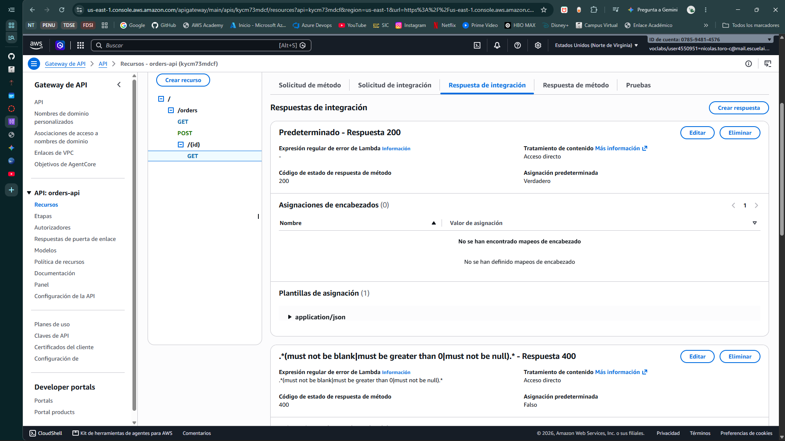
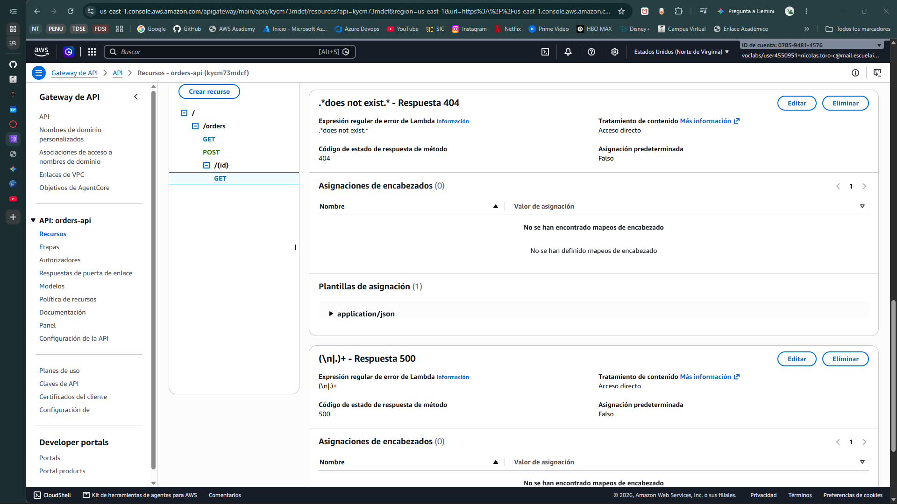
Status codes live in API Gateway's *Integration responses*, selected by a regular expression matched against the Lambda `errorMessage`. The specific patterns (404, 400) took precedence over the catch-all `(\n|.)+` (500), as the results below show.

**Successful retrieval — `200 OK`**
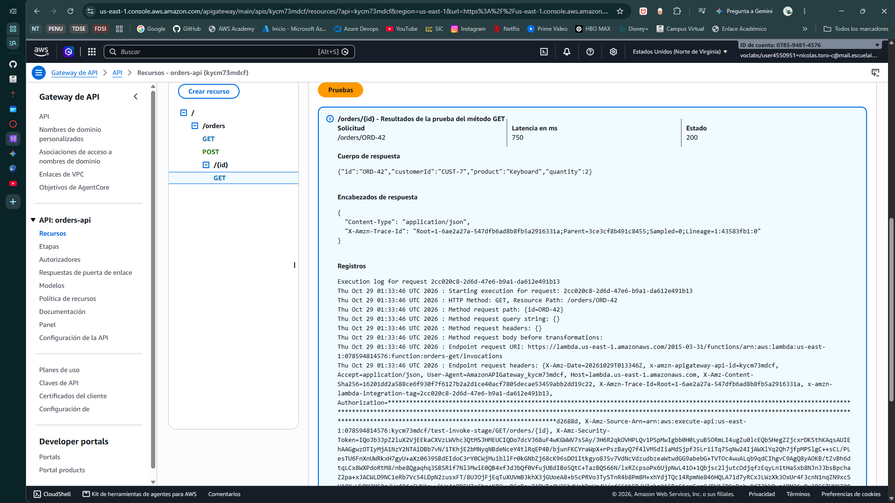
Existing order, returned as JSON.

**Order not found — `404 Not Found`**
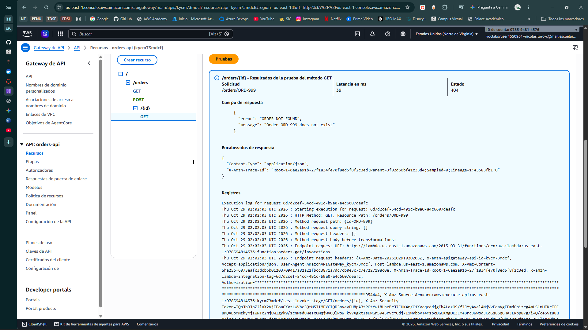
The domain exception `OrderNotFoundException` became a 404 with the contract's error document, built by a response template.

**Creation — `201 Created`**
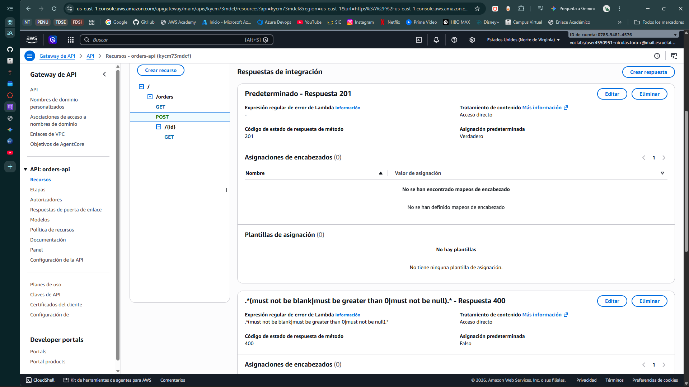
The default integration response was remapped from 200 to 201.

**Evidence of API working on URLs:**

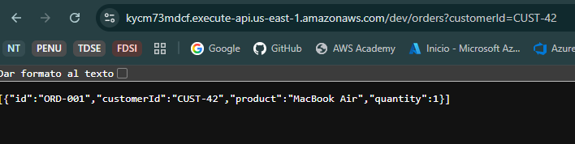
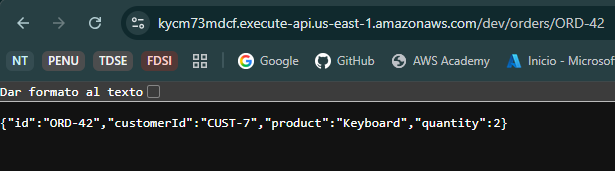

**Reproducibility:** the API was exported as OpenAPI with API Gateway extensions:
[`docs/api-gateway/architecture-a-openapi.json`](docs/api-gateway/architecture-a-openapi.json).

## 6. Part V — Lambda Proxy Integration

### The event sent by API Gateway
A throwaway echo Lambda was attached to a temporary resource to capture real events.
Examples are stored in `docs/examples/` (`proxy-event-get.json`, `proxy-event-post.json`;
IP addresses masked).

| Information | Location in the event |
|---|---|
| HTTP method | `httpMethod` |
| Path | `path` (actual) and `resource` (template, e.g. `/orders/{id}`) |
| Path parameters | `pathParameters` (`null` if none) |
| Query parameters | `queryStringParameters` (`null`, not `{}`, when absent) |
| Headers | `headers` / `multiValueHeaders` |
| Body | `body` — a **string** holding escaped JSON, plus `isBase64Encoded` |

Key consequences: the body must be parsed by our code, and absent maps are `null`.

## 7. Part VI — HTTP Adapter

`OrdersApiHandler` (package `edu.eci.tdse.orders.lambda`) is a thin adapter. It is the only
class that knows about API Gateway events, status codes, headers and JSON serialization.
`OrderService`, the model and the exceptions were **not modified** and still have no AWS or
Gson dependency.

- **One Lambda for the whole API.** The adapter routes on `httpMethod` + `resource`.
- **Single translation table** from domain exceptions to HTTP:
  `OrderNotFoundException → 404`, `InvalidOrderException → 400`,
  malformed JSON → 400, anything else → 500 with a generic message
  (details go to CloudWatch Logs, never to the client).
- **Errors are normal return values.** The Lambda invocation succeeds and returns
  `statusCode: 404`; no `errorType`/`errorMessage` and no regular expressions are involved.
- **`Location` header** on `201`, built from `requestContext.path` so that it includes the stage.
- **Locally testable:** `OrdersApiHandlerTest` builds `APIGatewayProxyRequestEvent` objects
  and verifies every HTTP behavior with `mvn test`, without AWS.

> Update to Checkpoint 1: the packaged JAR now also contains the adapter and its
> libraries (AWS events, Gson). The application classes themselves remain free of them.

### Evidence — Architecture B

**Direct invocation with a proxy event**
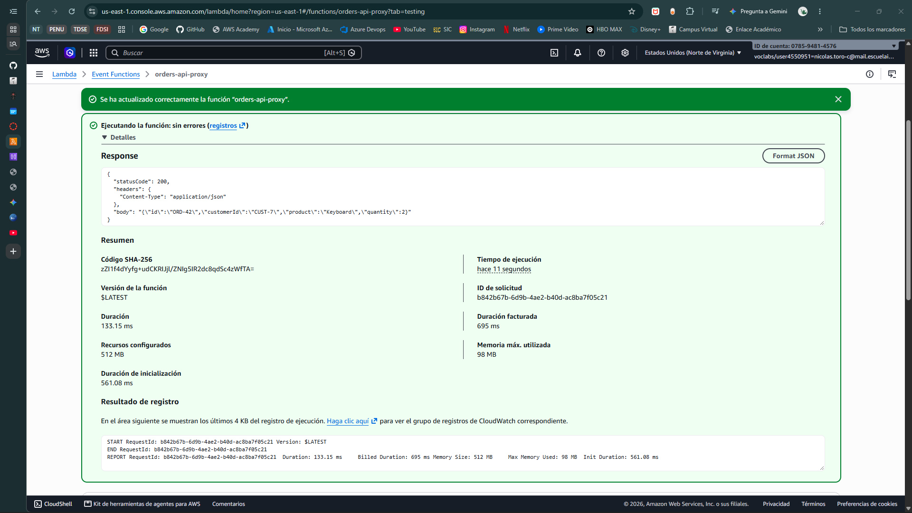
The Lambda returns an HTTP-shaped object: `statusCode`, `headers` and a string `body`.

**Error as a return value**
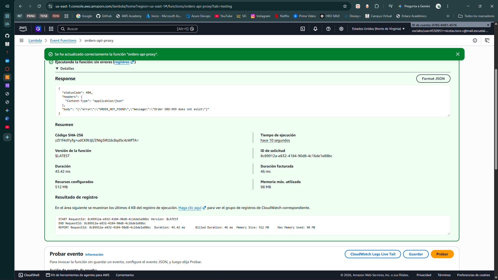
A missing order is a successful invocation returning `statusCode: 404`.

**Proxy method configuration**
  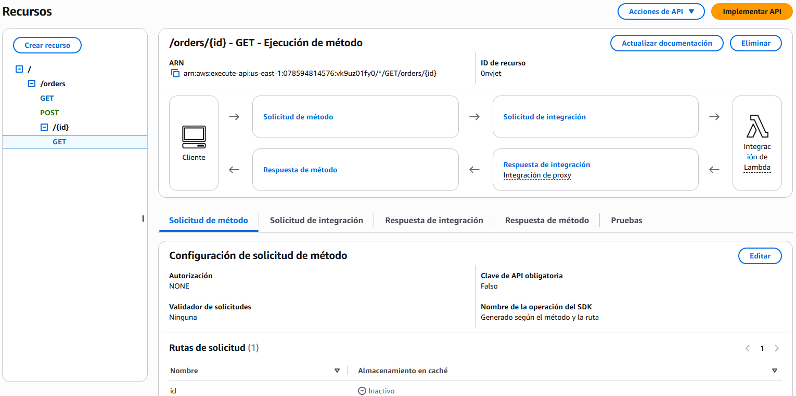
With Lambda proxy integration there are no mapping templates nor method/integration responses to configure.

**Deployed API calls** (`201` with `Location`, `404`, `400`, search...)
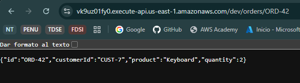
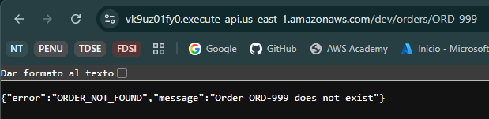

## 8. Comparison of the Two Architectures

| Question | Architecture A (mapping templates) | Architecture B (proxy + adapter) |
|---|---|---|
| API Gateway configuration (exported OpenAPI) | 206 lines / 6,524 bytes | 122 lines / 3,473 bytes |
| Java infrastructure code | None | `OrdersApiHandler` (144 lines) + 3 dependencies + shade plugin |
| Local testing of HTTP behavior | Not possible; requires deployment | Full, with `mvn test` (13 adapter tests) |
| Where status codes are defined | API Gateway integration responses | Java adapter |
| Lambdas | One per operation (3) | One for the whole API |

### 1. Which approach required more API Gateway configuration?
**A.** Each of the three methods needed a request mapping template, plus one method
response and one integration response (with its own regex and body template) for every
status code it could return. The exported definition is **206 lines (6,524 bytes) for A
versus 122 lines (3,473 bytes) for B**, so A needed roughly 1.7 times more lines and 1.9
times more bytes. In B each method is created once with proxy integration enabled and
nothing else has to be configured: API Gateway no longer interprets the request or the
response. The remaining 122 lines of B are mostly per-method boilerplate (resources,
methods, Lambda integration), not behavior.

### 2. Which approach required more Java infrastructure code?
**B.** A required no infrastructure Java at all, since plain methods of `OrderService`
were used as handlers. B required `OrdersApiHandler` (144 lines), the AWS events library,
Gson and the shade plugin, plus a 190-line test class. The effort moved from
configuration to code.

### 3. Which was easier to test locally?
**B.** Status codes, error documents, the `Location` header, null query parameters,
malformed JSON and the 500-without-leaking behavior are all verified by 13 JUnit tests
that run with `mvn test` and no AWS account. In A, only the application logic can be tested
locally; the templates and regexes can only be exercised against API Gateway. The console
test tool helps, but it is manual and cannot run in a build pipeline.

### 4. Where are HTTP status codes defined in each approach?
**A:** in API Gateway integration responses; a regular expression is matched against the
Lambda `errorMessage` and selects one of the declared method responses.
**B:** in Java, in the adapter (`handleRequest` and the operation methods), as explicit and
typed code: `catch (OrderNotFoundException e) → 404`.

### 5. What happens if the API grows from 3 operations to 30?
**A:** configuration grows linearly. The exported definition averages about 69 lines per
operation (206 / 3), so 30 operations would be roughly 2,000 lines of repeated templates,
regexes and response definitions to keep consistent by hand or generate with
infrastructure-as-code (a rough extrapolation, since part of the file is shared
boilerplate). Either 30 Lambdas are needed or a dispatching layer must be added, and
because the regexes depend on message text, the risk of silent inconsistencies grows too.
**B:** the API Gateway configuration also grows (about 41 lines per operation, 122 / 3),
but the behavior does not live there. The adapter grows as code, which can be refactored
(a route table, one handler per resource, a shared error translator), reviewed and tested.
The risk is a "god handler" and one large Lambda (longer cold starts, shared permissions,
larger blast radius), which can be mitigated by splitting the adapter per resource while
keeping the same pattern.

### 6. Which approach makes the Java business logic cleaner?
**Neither changed it:** `OrderService`, the model and the exceptions are identical in both
architectures and have no HTTP or AWS dependency. The difference is *where the HTTP
complexity lives*: in API Gateway configuration (A) or in a separate adapter (B). A subtle
point in favor of B: in A the exception **messages** became part of the API behavior
(rewording `does not exist` would silently turn a 404 into a 500), so the logic is
indirectly coupled to the gateway configuration. In B the coupling is on exception
**types**, checked by the compiler and by tests.

### 7. Which approach would be easier for another developer to understand?
**B.** Behavior can be read in one class, followed with a debugger and understood through
its tests. In A the behavior is spread across the Java code, VTL templates and regular
expressions stored in the AWS console, and understanding it means clicking through
several tabs per method. B does require knowing the proxy event format.

### 8. Which approach would you choose for a larger system? Why?
**B (proxy integration with a thin adapter), managed with infrastructure-as-code.**
Reasons: its behavior is testable without deploying, versioned and reviewable in Git,
expressive enough for things A could not do easily (the `Location` header), and its error
mapping depends on types instead of strings. The price is more Java code and coupling of the
function to the event format, which a thin adapter keeps contained.
A remains reasonable when the backend cannot be modified, when a simple transformation is
enough, or for small integrations that will not grow.

## 9. Final Challenge — DELETE /orders/{id}

The prediction was written and committed **before** the implementation
(see `docs/prediction-delete.md` and the git history).

### AI assistant's proposal
Before writing code, the assistant proposed: a new `deleteOrder` operation in `OrderService`
(returning `void` and throwing `OrderNotFoundException` for a missing order, like `getOrder`),
a new route in `OrdersApiHandler` returning `204`, no change to the model or the exceptions,
no new Lambda, and a new `DELETE` method in API Gateway. DELETE was added only to
Architecture B, which is the final API.

### Prediction vs. reality

| # | Question | My prediction | What was needed | Result |
|---|---|---|---|---|
| 1 | Java classes that change | `OrdersApiHandler`, `OrderService` | `OrdersApiHandler` and `OrderService`; `Order` did not change | Correct |
| 2 | New Lambda? | No | No | Correct |
| 3 | API Gateway change? | Create a `DELETE` method and redeploy | Same; additionally the Lambda package had to be redeployed with the new code | Correct, with one omission |
| 4 | Where does the deletion logic reside? | In the handler and the service | In `OrderService.deleteOrder`; the handler only translates | Incorrect |
| 5 | Where is 204 vs 404 decided? | In the handler | The handler decides the status code; the service only reports *whether* the order exists | Correct, with a nuance |
| 6 | Tests | (drafted with the assistant) | Service tests, adapter tests, manual API checks | Matched |

### Analysis of the differences

**Question 1 — `Order`.** I expected the model to change, but deleting an order needs no new
state or behavior in `Order`. The collection is owned by the service, so removing an item is
a change to the collection, not to the item. I could not name a concrete change when I
wrote the prediction, which was a sign that the prediction was weak there.

**Question 4 — the most important mistake.** My prediction was internally inconsistent: I
said `OrderService` would change (question 1) but that the deletion logic would live in the
handler (question 4). The orders collection is a private field of `OrderService`; the handler
cannot remove an item from it unless the service offers an operation to do so. Deleting is
business logic, so it belongs in the service, and the handler only wires HTTP to it. I had
confused *invoking* the operation (adapter) with *performing* it (application).

**Question 5 — a nuance.** I was right that the status code belongs to the handler. What I
had not distinguished is the two separate decisions hidden in "204 or 404":
*does the order exist?* is a business fact decided by the service (it throws
`OrderNotFoundException`), and *which number represents that fact* is decided by the adapter.
The existing translation table already covered the 404; only the 204 had to be written.

**Question 3 — the omission.** I did not consider that the Lambda code itself had to be
redeployed. With the old package, `DELETE` reached the function but returned
`ROUTE_NOT_FOUND`. Configuration (API Gateway) and code (Lambda package) are two separate
deployment steps.

### Conclusion
The change touched exactly one business class (`OrderService`) and one adapter class
(`OrdersApiHandler`), and required one new API Gateway method. The central expectation of
the workshop held: adding an operation did not require touching the domain exceptions, the
model or the existing routes, because responsibilities were already separated. Doing the same
in Architecture A would have required a fourth Lambda, a new method with a request template,
and three response definitions with their regular expressions.

### Evidence
**204 No Content (existing order)**
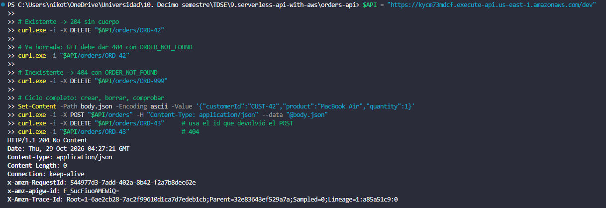

**404 Not Found (non-existent order)**
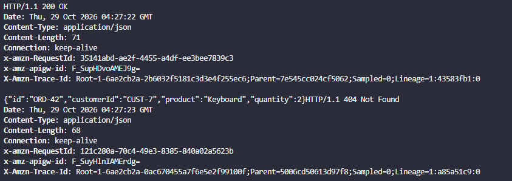

**Deleted order is no longer retrievable**
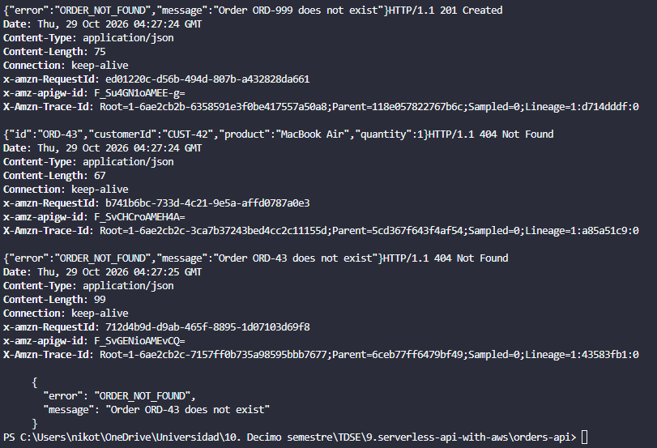
