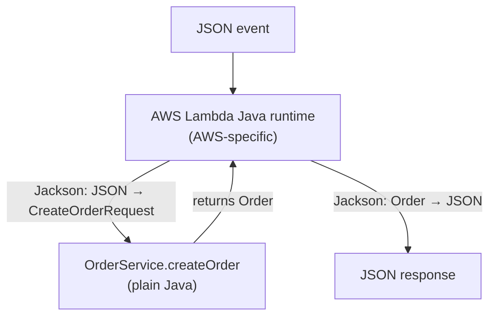

# Designing a Serverless REST API with AWS Lambda and API Gateway

## Digital Transformation in Enterprise Systems (TDSE) - Lab 9

## Nicolás Toro Criollo

---

## Project title and description

[TO DO: Fill in your project title and description here]

---

# Orders API — Serverless REST API with AWS Lambda and API Gateway

## 1. API Contract

### Resources
- `orders` (collection): `/orders`
- `order` (single item): `/orders/{id}`

### Order representation
{
  "id": "ORD-001",
  "customerId": "CUST-42",
  "product": "MacBook Air",
  "quantity": 1
}

### Error representation
{
  "error": "ORDER_NOT_FOUND",
  "message": "Order ORD-999 does not exist"
}

### Operations

| Operation | Method | URL | Path param | Query param | Request body | Success | Errors |
|---|---|---|---|---|---|---|---|
| Create order | POST | `/orders` | – | – | `{customerId, product, quantity}` | `201 Created` + order JSON (+ `Location: /orders/{id}`) | `400 INVALID_REQUEST`, `500 INTERNAL_ERROR` |
| Get order | GET | `/orders/{id}` | `id` | – | – | `200 OK` + order JSON | `404 ORDER_NOT_FOUND`, `500 INTERNAL_ERROR` |
| Find by customer | GET | `/orders?customerId={customerId}` | – | `customerId` | – | `200 OK` + JSON array (empty array if none) | `400 MISSING_CUSTOMER_ID`, `500 INTERNAL_ERROR` |
| Delete order (final challenge) | DELETE | `/orders/{id}` | `id` | – | – | `204 No Content` (no body) | `404 ORDER_NOT_FOUND`, `500 INTERNAL_ERROR` |

### Error codes
| HTTP status | `error` | When |
|---|---|---|
| 400 | `INVALID_REQUEST` | Malformed JSON, missing/blank fields, `quantity <= 0` |
| 400 | `MISSING_CUSTOMER_ID` | `GET /orders` without `customerId` |
| 404 | `ORDER_NOT_FOUND` | The order id does not exist |
| 500 | `INTERNAL_ERROR` | Unexpected failure (no internal details leaked) |

## 2. Design Questions

**What are the resources in your API?**
The main resource is the *order*. It is exposed as a collection (`/orders`) and as an individual item (`/orders/{id}`).

**Why did you choose `/orders/{id}` to retrieve a particular order?**
In REST, a URL identifies a resource. The `id` is part of the identity of one specific order, so it belongs in the path. The URL is stable, cacheable, and can be used by DELETE as well, following the same resource-oriented model.

**Why is `customerId` a query parameter in the search operation?**
`customerId` is not the identity of an order; it is a filter applied to the collection `/orders`. Query parameters are meant for optional filtering, searching, and sorting. The collection keeps the same URL and the filter narrows it.

**What should `POST /orders` return when an order is created?**
`201 Created` with the created order in the body (including the server-generated `id`) and a `Location: /orders/{id}` header pointing to the new resource.

**What should the API return when an order does not exist?**
`404 Not Found` with the standard JSON error body (`ORDER_NOT_FOUND`).

**What information should an error response contain?**
A stable, machine-readable `error` code (so clients can branch on it) and a human-readable `message`. It must not expose stack traces or internal details. The HTTP status code carries the category of failure; the body gives the specific reason.

## 3. Part I — Plain Java Application

The application logic is a plain Java 17 library. It has **no dependency** on HTTP,
API Gateway, Spring Boot, a web server or any AWS class. Its only dependency is JUnit,
and only in the `test` scope.

### Structure

orders-api/
├── pom.xml
└── src/
    ├── main/java/edu/eci/tdse/orders/
    │   ├── model/
    │   │   ├── Order.java
    │   │   └── CreateOrderRequest.java
    │   ├── exception/
    │   │   ├── OrderNotFoundException.java
    │   │   └── InvalidOrderException.java
    │   └── service/
    │       └── OrderService.java
    └── test/java/edu/eci/tdse/orders/service/
        └── OrderServiceTest.java

### Design decisions

- **Domain exceptions instead of status codes.** The service signals problems with
  `OrderNotFoundException` and `InvalidOrderException`. It never knows what a "404" is.
  Translating exceptions to HTTP is the job of an outer layer (API Gateway or the adapter).
- **Validation lives in the application logic.** Rules such as "quantity must be positive"
  are business rules, so they must hold regardless of how the service is invoked
  (Lambda direct, API Gateway, a unit test).
- **JavaBean-style model classes** (public no-arg constructor, getters and setters). This
  lets the AWS Lambda Java runtime convert JSON to objects and back in Part II without
  adding any AWS dependency to the model.
- **In-memory storage.** Orders are kept in a `ConcurrentHashMap`. This is *not*
  persistent: Lambda execution environments are ephemeral, so data may disappear
  whenever the environment is recycled.

### Checkpoint 1

**Can the application functionality be tested without AWS?**
Yes. `OrderServiceTest` instantiates `OrderService` directly and runs with `mvn test`.
No AWS account, network access or emulator is needed.

**Does your application require a web server?**
No. The service is a plain Java class with methods. Nothing listens on a port.

**Does it require Spring Boot?**
No. The only dependency is JUnit, restricted to the `test` scope.

**What does the generated JAR contain?**
The compiled `.class` files of the model, exceptions and service, plus
`META-INF/MANIFEST.MF` and the Maven metadata. It contains neither the test classes nor
any third-party library, so it is small and has no transitive dependencies.

**Which parts of your application currently know about HTTP?**
None. The application only knows about orders, customers, products, quantities and
domain exceptions. Status codes and headers will be introduced later, outside this layer.

## 4. Part II — Deploying a Java Function to AWS Lambda

`OrderService.createOrder` is deployed as an AWS Lambda function **without modifying
any Java code**. The Lambda Java runtime accepts a plain public method as handler
(`package.Class::method`), so no AWS dependency was added to the project.

| Setting | Value |
|---|---|
| Function name | `orders-create` |
| Runtime | Java 17 |
| Handler | `edu.eci.tdse.orders.service.OrderService::createOrder` |
| Package | `target/orders-api-1.0.0.jar` |
| Memory / Timeout | 512 MB / 15 s |

### Investigation: JSON ↔ Java conversion in the Lambda Java runtime

The Lambda Java runtime inspects the handler method signature through reflection,
deserializes the incoming JSON into the declared parameter type (`CreateOrderRequest`)
using Jackson, invokes the method, and serializes the returned object (`Order`) back to JSON
through its getters. JSON property names therefore come from JavaBean accessors, which is
why the model classes have a public no-arg constructor and getters/setters.

### Verification against the deployed function

**Valid order** (`quantity: 1`)

The runtime deserialized the JSON into `CreateOrderRequest`, our method ran, and the returned `Order` was serialized back to JSON.

**Domain error** (`quantity: 0`)

`errorType` is our own `InvalidOrderException`: our code ran and the domain exception crossed the runtime.

**Missing field** (`product` omitted)

The error comes from the runtime's JSON conversion, *before* our method was invoked.

**Type mismatch** (`quantity: "abc"`)

The error comes from the runtime's JSON conversion, *before* our method was invoked.

### Checkpoint 2 — Architecture of Part II

